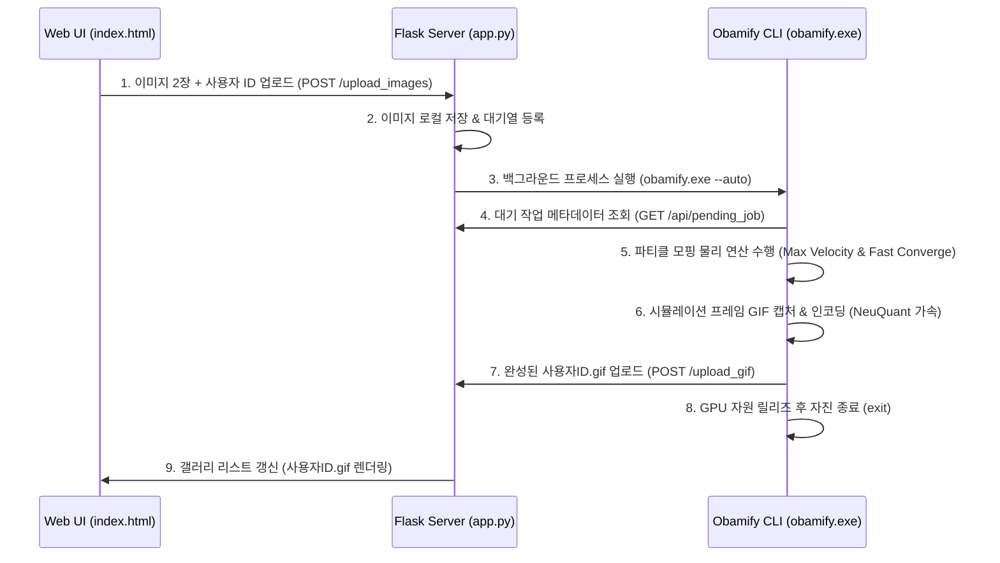

# 📸 사다네컷 × Obamify 자동화 프로젝트

사다네컷(SADA) 부스에서 대기 중인 사용자의 얼굴(Source)과 합성 대상(Target) 이미지 2장을 활용하여 실시간으로 오바미파이(Obamify) 물리 연산 기반의 모핑 GIF 애니메이션을 자동 생성해 주는 서비스 파이프라인 프로젝트입니다.

부스의 높은 순환율(회전율)을 극대화하기 위해 다방면의 성능 튜닝 및 라이프사이클 최적화를 적용했습니다.

---

## 🏗️ 시스템 아키텍처



---

## ⚡ 순환율 극대화 성능 최적화 가이드라인

부스 참가자 대기시간을 대폭 감소시키기 위해 적용된 핵심 최적화 설정입니다:

1. **GPU/WGPU 디바이스 생명주기 관리**:
   - `eframe`의 고유 제약인 프로세스당 단일 GPU 컨텍스트 생성 한계를 우회하기 위해, 매번 띄우는 프로세스 단발성(`--auto` 단일 처리 후 `std::process::exit(0)`) 구동 구조를 정립하였습니다.
   - 변환이 끝나면 GPU 리소스를 OS 수준에서 완벽하게 해제하므로 그래픽 오류나 먹통 현상이 발생하지 않습니다.
2. **GIF 크기 및 프레임 최적화**:
   - **해상도 축소**: GIF 해상도를 기존 $400 \times 400$에서 $300 \times 300$으로 축소하여 총 연산 화소 수를 44% 이상 감소시켰습니다.
   - **프레임 다이어트**: 변환 프레임 수를 최소 `40` ~ 최대 `50`프레임으로 축소하여 디코딩/인코딩 병목을 단축했습니다.
3. **NeuQuant 색상 양자화 속도 가속**:
   - 뉴퀀트 팔레트 샘플링 팩터(`GIF_PALETTE_SAMPLEFAC`)를 `1`에서 `10`으로 높여 색상 분석 시간을 약 10배 가속하였습니다.
4. **물리 물리 시뮬레이션 가속화**:
   - 파티클의 최대 이동 속도(`MAX_VELOCITY`)를 `6.0`에서 `24.0`으로 4배 향상했습니다.
   - 파티클 반발 거리 간격(`PERSONAL_SPACE`)을 `0.95`에서 `0.6`으로 압축하여 타겟 이미지로 빠르게 안착시켰습니다.
   - GPU 렌더 프레임당 업데이트 스텝을 2배(`120 / GIF_FRAMERATE`)로 늘려 실제 전체 시퀀스 진행 시간을 기존 **40초대에서 10초 내외로 단축**했습니다.

---

## ⚙️ 설치 및 빌드 방법

### 1. Flask 백엔드 의존성 설치
`.venv` 가상환경이 구축된 상태에서 아래 패키지들을 설치합니다.
```powershell
cd .venv/Scripts
# 가상환경 활성화
.\Activate.ps1
# 필수 패키지 설치
pip install Flask requests
```

### 2. Rust CLI (obamify) 빌드
그래픽 디바이스 연산 가속을 위해 반드시 **릴리즈 모드**로 빌드해 주어야 합니다.
```powershell
cd obamify
cargo build --release
```
*빌드가 정상 완료되면 `obamify/target/release/obamify.exe` 파일이 생성됩니다.*

---

## 🚀 실행 및 사용 방법

1. **Flask 백엔드 서버 구동**:
   ```powershell
   cd .venv/Scripts
   python app.py
   ```
   * Flask 웹 서비스가 `http://127.0.0.1:5000` 포트에서 대기합니다.
   * `app.py`는 사용자가 업로드할 때마다 빌드된 `obamify/target/release/obamify.exe`를 감지하여 자동으로 서브프로세스로 기동시킵니다. 따라서 별도로 Rust 프로그램을 수동으로 띄워놓을 필요가 없습니다.

2. **웹 화면 접속**:
   * 크롬이나 웨일 브라우저로 `http://localhost:5000`에 접속합니다.
   * **사용자 ID (User ID)**를 적습니다. (예: `happy_booth`)
   * **원본(Source) 이미지**와 **대상(Target) 이미지** 2장을 각각 드래그 앤 드롭하여 업로드합니다.
   * **"서버로 업로드"** 버튼을 클릭합니다.
   * 잠시 후(약 10초) 화면 하단 갤러리에 `happy_booth.gif`가 실시간으로 로드됩니다!
