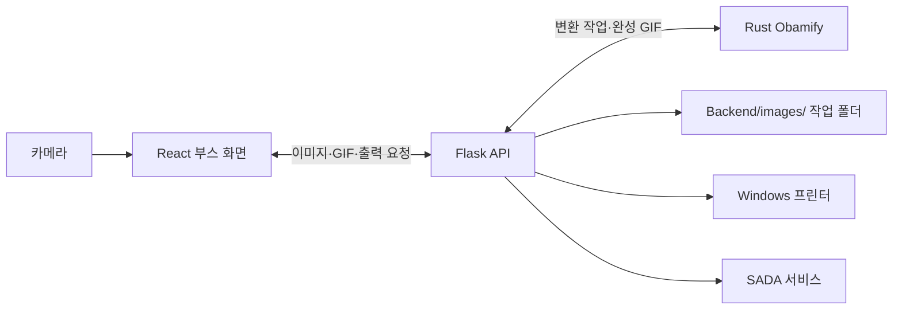

# 2026 사다네컷 포토부스

카메라로 촬영한 사진을 골라 사다네컷 인화용 이미지와 GIF를 만드는 Windows 포토부스입니다. 촬영 화면에서 Obamify 또는 Image Morphing을 선택할 수 있으며, 완성된 사진을 부스 프린터로 출력하거나 SADA 서비스로 전송할 수 있습니다.

## 프로그램 구성

| 경로 | 역할 |
| --- | --- |
| [`src/`](src/) | React·TypeScript 부스 화면. 카메라 촬영, 사진 선택, 결과 미리보기, 출력 및 전송을 담당합니다. |
| [`public/images/`](public/images/) | 인화용 프레임과 알고리즘 미리보기 이미지입니다. |
| [`Backend/app.py`](Backend/app.py) | Flask API. 사진과 GIF 저장, Obamify 실행, 모핑 GIF 인코딩, Windows 프린터 출력, SADA 전송을 처리합니다. |
| [`obamify/`](obamify/) | Rust·wgpu 기반 이미지 변환 프로그램입니다. Flask가 실행 파일을 `--auto`로 시작하면 이미지를 가져와 변환하고, 완성된 GIF를 Flask에 돌려줍니다. |
| [`morphing/`](morphing/) | 별도로 열어볼 수 있는 이미지 모핑 데모입니다. 부스의 모핑 경로는 React 화면에서 중간 프레임을 만들고 Flask에서 GIF로 인코딩합니다. |

## 시스템 구조와 구동 원리



### 프런트엔드 · 촬영에서 미리보기까지

React가 브라우저 카메라 권한을 요청하고 최대 8장을 촬영합니다. 사용자는 인화 틀에 넣을 원본 4장과 변환에 사용할 사진을 선택합니다. 브라우저의 Canvas가 원본 사진, 변환 프레임, 부스용 틀을 한 장의 인화용 JPEG로 합칩니다. 결과 화면에서 미리보기를 확인하고 인화 매수나 SADA 전송 정보를 입력합니다.

### 두 가지 이미지 변환 방식

| 방식 | 처리 흐름 |
| --- | --- |
| **Image Morphing** | 부스 화면의 Canvas가 두 사진의 투명도를 단계적으로 바꿔 24장의 전환 프레임을 만듭니다. React가 프레임을 `POST /api/create_morph_gif`로 보내면 Flask가 Pillow로 GIF를 인코딩하고 결과 주소를 반환합니다. |
| **Obamify** | React가 사진 두 장을 `POST /upload_images`로 보냅니다. Flask는 사진을 저장하고 `obamify.exe --auto`를 실행합니다. Rust 프로그램은 `GET /api/pending_job`에서 작업을 가져와 GPU에서 파티클을 움직이는 방식으로 이미지를 변환합니다. 완성한 GIF를 `POST /upload_gif`로 돌려준 뒤 종료합니다. Flask가 GIF에서 대표 프레임을 추출하고, React는 결과 주소를 주기적으로 확인해 미리보기를 표시합니다. |

Flask는 Obamify의 대기 작업을 메모리의 `current_job` 한 건으로 관리합니다. 부스에서는 한 번에 한 건씩 진행합니다. [`Backend/templates/index.html`](Backend/templates/index.html)에는 초기 Obamify 업로드·갤러리 화면이 남아 있습니다. 현재 Flask의 `/`는 상태 JSON을 반환하며, 부스 화면은 React 서버에서 엽니다.

### 백엔드 · 저장, 인화, SADA 전송

1. **저장.** Flask는 전달받은 원본과 결과물, 처리 기록을 작업별 폴더에 저장합니다. 작업 기록은 각 폴더의 `events.jsonl`에 남습니다.
2. **인화.** React는 합성한 JPEG와 매수를 `POST /api/print`로 보냅니다. Flask는 지정된 Windows 프린터에 매수만큼 출력 작업을 제출합니다. 0장이면 출력 작업을 건너뜁니다.
3. **SADA 전송.** React는 입력받은 식별자와 결과 JPEG, 준비된 GIF를 `POST /api/send_sadanecut_file`로 보냅니다. Flask가 부스 키를 붙여 SADA 서비스로 전달합니다.

## Windows에서 실행하기

Node.js와 npm, Python, Rust 도구가 필요합니다. 촬영에는 카메라가 필요하며, 실물 인화에는 Windows에 등록된 프린터가 필요합니다.

저장소 루트에서 의존성을 설치합니다.

```powershell
npm.cmd ci
py -m venv .venv
.\.venv\Scripts\python.exe -m pip install -r Backend/requirements.txt
```

Obamify를 사용할 경우 Rust 프로그램을 먼저 빌드합니다. Flask는 `obamify/target/release/obamify.exe`를 우선 찾습니다.

```powershell
Push-Location obamify
cargo build --release
Pop-Location
```

첫 번째 터미널에서 Flask를 실행합니다.

```powershell
.\.venv\Scripts\python.exe Backend/app.py
```

두 번째 터미널에서 React 개발 서버를 실행한 뒤 `http://localhost:3000`을 엽니다. React 개발 서버는 API 요청을 `http://127.0.0.1:5000`의 Flask로 전달합니다.

```powershell
npm.cmd start
```

프런트엔드 정적 빌드는 `npm.cmd run build`로 `build/`에 생성됩니다. 정적 빌드를 서비스할 때는 같은 출처에서 Flask API 경로를 제공해야 합니다.

## 부스 설정과 저장 위치

| 환경 변수 | 용도 |
| --- | --- |
| `SELPHY_PRINTER_NAME` | Windows에 등록된 프린터 이름입니다. 기본값은 `Canon SELPHY CP1500`입니다. |
| `SADANECUT_BOOTH_KEY` | SADA 서비스로 사진과 GIF를 전송할 때 사용하는 키입니다. 전송 기능을 사용할 경우 Flask를 시작하는 터미널에 설정합니다. |

원본 사진, 생성 이미지와 GIF, 작업 로그는 `Backend/images/` 아래 작업별 폴더에 저장됩니다. 이 폴더와 `.venv/`는 Git에서 제외됩니다.

## 부스 확인 항목

1. 브라우저에서 카메라를 허용하고 촬영한 뒤, 인화 틀에 넣을 사진을 선택합니다.
2. Image Morphing과 Obamify를 각각 선택해 결과 미리보기와 GIF가 표시되는지 확인합니다.
3. 프린터가 연결된 부스에서 인화 매수를 1장으로 선택하고, 실제 출력물의 방향과 잘림을 확인합니다.
4. SADA 전송을 사용하는 부스에서는 테스트용 6자리 코드로 사진과 GIF가 도착하는지 확인합니다.
